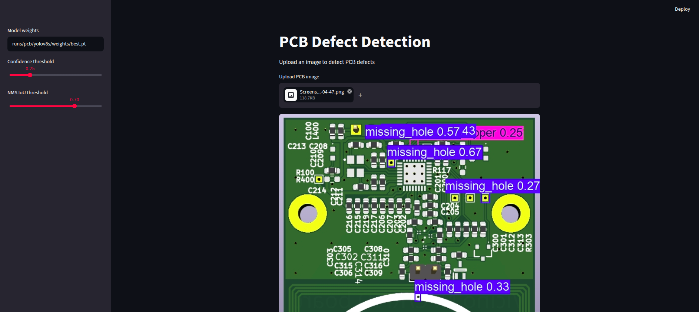
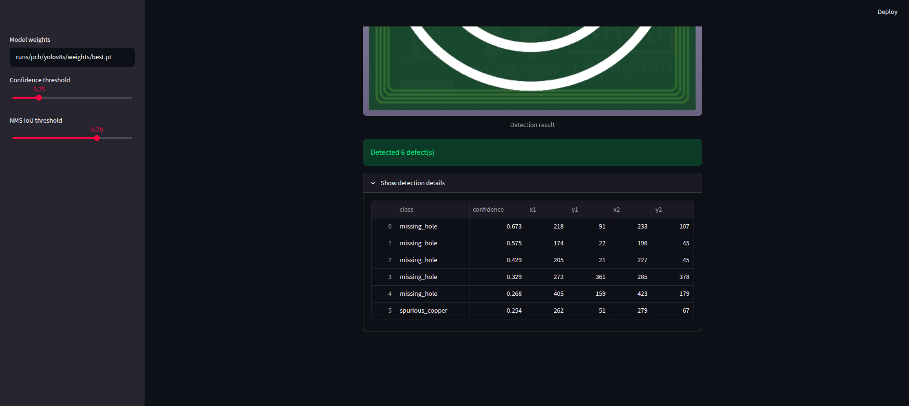
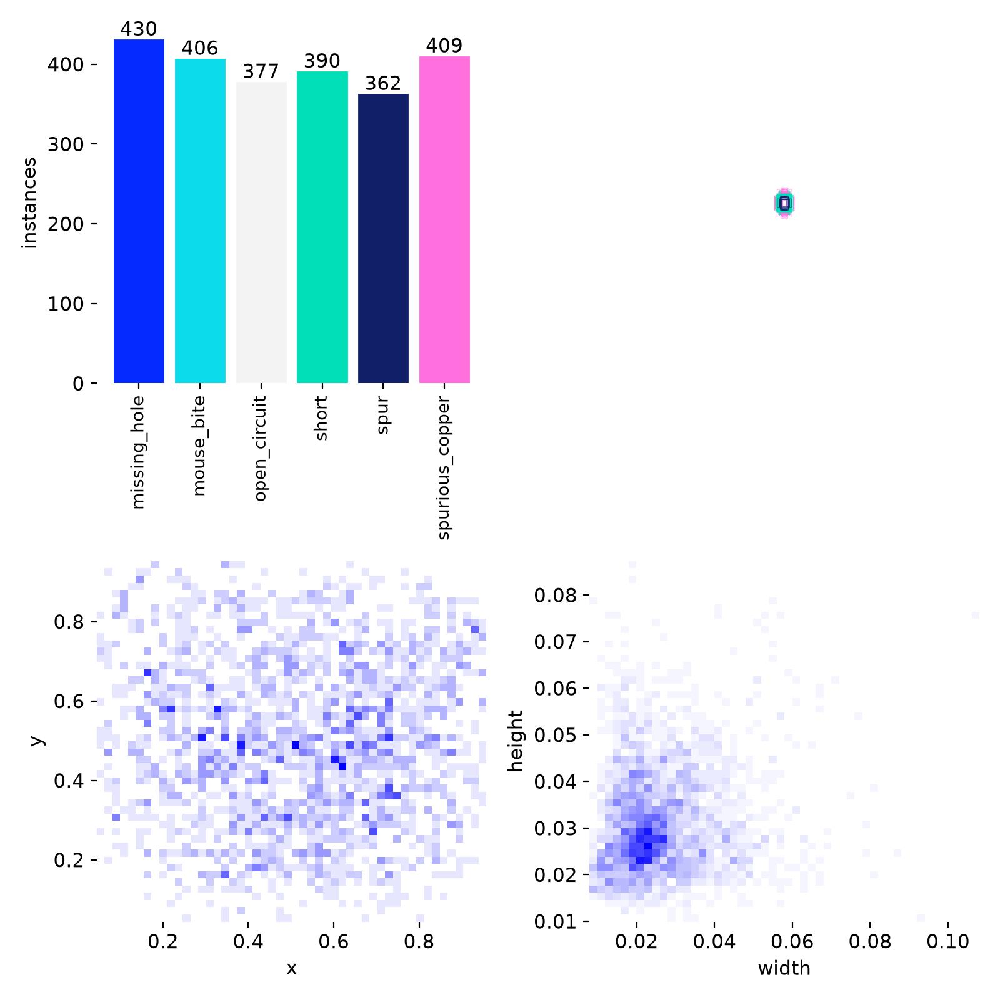
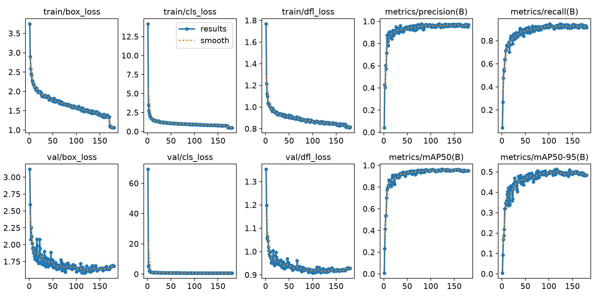
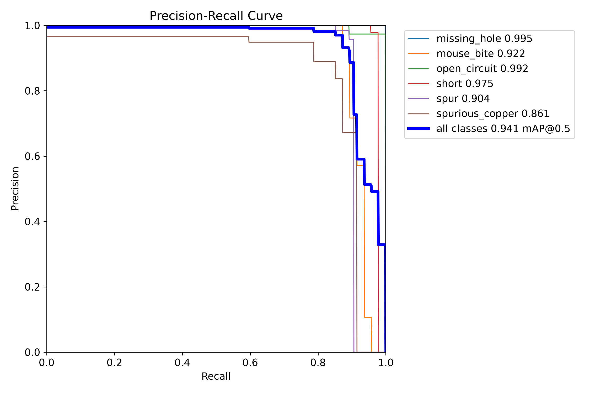
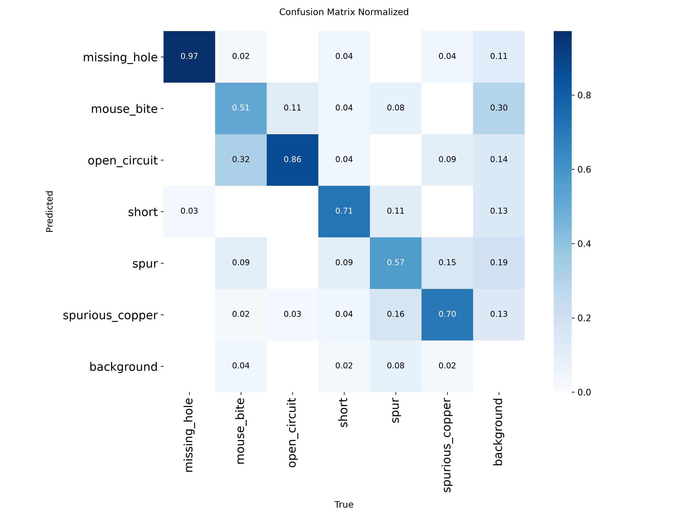
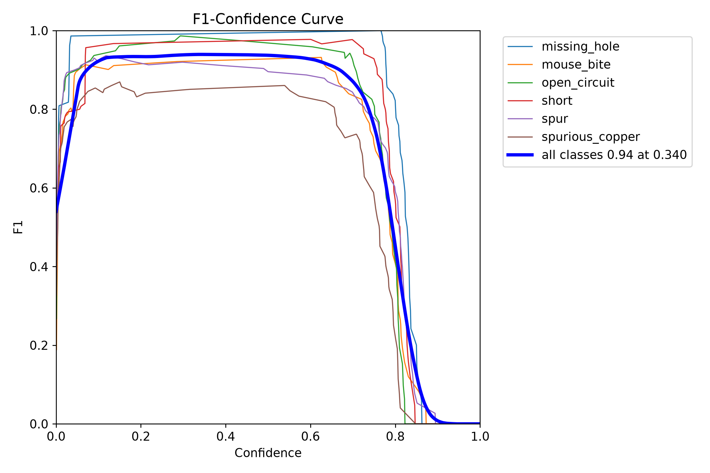

# 🟩 PCB_Defect_Detect

[](https://pcb-defectdetect.streamlit.app/)
[](https://huggingface.co/Sulojan/pcb-defect-yolov8s)

**Live demo: <https://pcb-defectdetect.streamlit.app/>**: upload a PCB image and get its defects detected in the browser.

This repository contains custom PCB-Defect_Detection model powered by YOLOv8. And also have real-time **Printed Circuit Board (PCB) defect detection** system which enables users to upload PCB images and automatically identifies defects using a trained object detection model, with deployment using **Streamlit** for a simple web interface.

## 📌 Project Overview

This project leverages **YOLOv8** to detect manufacturing defects in PCBs. It includes training on a custom dataset, followed by deploying the model using **Streamlit** to allow users to test the system with their own images.

---

## 📁 Repository Structure

```
📦 PCB_Defect_Detect/
├── configs/
│   ├── data.yaml               # Raw dataset path, classes, resize, split ratios, seed
│   └── train/yolov8s.yaml      # Model + Ultralytics training hyperparameters
├── src/
│   ├── download_data.py        # Download Kaggle dataset + symlink to data/raw
│   ├── data.py                 # VOC XML parsing, YOLO box conversion
│   ├── prepare_data.py         # Raw VOC dataset -> YOLO train/val/test dataset
│   ├── visualize.py            # Class stats + ground-truth box visualisation
│   ├── train.py                # Train from a config (+ key=value overrides)
│   ├── evaluate.py             # Evaluate weights on a split, save metrics.json
│   ├── predict.py              # Batch inference, saves annotated images
│   └── models.py               # Loads YOLO or RT-DETR weights
├── app/
│   ├── streamlit_app.py        # Streamlit web app for real-time inference
│   └── requirements.txt        # CPU-only deps for Streamlit Community Cloud
├── deploy/hf_model/README.md   # Model card for the Hugging Face weights repo
├── packages.txt                # System packages for Streamlit Community Cloud
├── test_images/                # Sample test images for inference
├── test_predictions/           # Saved prediction outputs
├── snippets/                   # App screenshots, result plots, inference/ sample outputs
└── requirements.txt
```

---

## 🧪 Dataset

- **Dataset used**: [`pcb-defects`](https://www.kaggle.com/datasets/akhatova/pcb-defects) on Kaggle (693 images, 6 defect classes, Pascal VOC XML)
- Download it with `python -m src.download_data`. This fetches it via `kagglehub` (cached in `~/.cache/kagglehub`) and symlinks it to `data/raw/PCB_DATASET` (the `raw_dir` in `configs/data.yaml`)
- If Kaggle asks for credentials, create an API token at <https://www.kaggle.com/settings> and save it as `~/.kaggle/kaggle.json` (or export `KAGGLE_USERNAME` / `KAGGLE_KEY`)

---

## ⚙️ Setup

```bash
pip install -r requirements.txt
```

---

## 🚀 Usage

```bash
# 0. Download the dataset and symlink it to data/raw/PCB_DATASET
python -m src.download_data

# 1. Explore the dataset (optionally draw boxes on one image)
python -m src.visualize --image 01_short_07.jpg

# 2. Convert VOC -> YOLO and split into train/val/test (writes data/processed/pcb.yaml)
python -m src.prepare_data --config configs/data.yaml

# 3. Train (any Ultralytics train arg can be overridden as key=value)
python -m src.train --config configs/train/yolov8s.yaml
python -m src.train --config configs/train/yolov8s.yaml epochs=1 batch=4   # quick smoke test

# 4. Evaluate on the held-out test split (writes metrics.json)
python -m src.evaluate --weights runs/pcb/yolov8s/weights/best.pt --split test

# 5. Predict on your own images
python -m src.predict --weights runs/pcb/yolov8s/weights/best.pt --source test_images --out test_predictions
```

To try another architecture, copy `configs/train/yolov8s.yaml` and change `model:`
(e.g. `yolo11s.pt`, `rtdetr-l.pt`) and `name:`.

### Streamlit app

```bash
streamlit run app/streamlit_app.py
```

Upload a `.jpg`, `.jpeg`, or `.png` image to see predicted defect boxes. Weights path and confidence/IoU thresholds are set in the sidebar.

### Deployment

The app is live at **<https://pcb-defectdetect.streamlit.app/>** on Streamlit Community Cloud. The trained weights are hosted on the Hugging Face Hub at [`Sulojan/pcb-defect-yolov8s`](https://huggingface.co/Sulojan/pcb-defect-yolov8s). When the `HF_MODEL_REPO` environment variable is set, the app downloads the weights from there instead of using the local `runs/` folder.

- [`app/requirements.txt`](app/requirements.txt): CPU-only dependencies the cloud installs (the root `requirements.txt` is for local GPU training)
- [`packages.txt`](packages.txt): system libraries OpenCV needs
- [`deploy/hf_model/README.md`](deploy/hf_model/README.md): model card for the Hub repo

### Example output

| Detection result | Detection details |
|---|---|
|  |  |

This board is not from the training dataset, so confidences are lower (0.25–0.67) than on the test set. The 10 board designs in the dataset don't cover every PCB layout.

More sample predictions on held-out test images (one per defect class) are in [`snippets/inference/`](snippets/inference/).

---

## 🧠 Results

### Training setup

| | |
|---|---|
| Model | YOLOv8s (COCO-pretrained, 11.1M params, 28.4 GFLOPs) |
| Input | 640×640 (images resized from 3034×1586) |
| Optimizer | AdamW, lr0 = 0.001, lrf = 0.0001, momentum = 0.9 |
| Schedule | 180 epochs, batch 16, mixup 0.3, mosaic (off for last 10 epochs) |
| Split (seed 42) | train 554 images / 2374 boxes · val 69 / 293 · test 70 / 286 |
| Training time | ~42 min |
| Best checkpoint | epoch 116 (val mAP50-95 0.513) |

Config: [`configs/train/yolov8s.yaml`](configs/train/yolov8s.yaml)

### Test set results (held out, 70 images, 286 boxes)

| Class | mAP50 | mAP50-95 |
|---|---|---|
| **all** | **0.941** | **0.503** |
| missing_hole | 0.995 | 0.657 |
| mouse_bite | 0.922 | 0.512 |
| open_circuit | 0.992 | 0.538 |
| short | 0.975 | 0.502 |
| spur | 0.904 | 0.448 |
| spurious_copper | 0.861 | 0.362 |

Precision 0.972 · Recall 0.912 · Inference 18.4 ms/image (640px)

The earlier Kaggle notebook version of this project reported mAP50 0.956 / mAP50-95 0.524. That was on its 34-image validation set, which was also used to pick the best checkpoint, so it was optimistic. The numbers above come from images the model never saw during training or checkpoint selection.

### Dataset labels



The classes are well balanced (362–430 boxes each in the training split), and defects appear all over the board. Most boxes are only 2–3% of the image's width and height, so small-object detection is the core difficulty.

### Training curves



- Validation mAP50-95 levels off around epoch 100–120. After that, validation box loss rises slightly while training loss keeps falling, which is mild overfitting. About 120 epochs (or `patience=30`) would be enough.
- The sharp drop in training loss near epoch 170 is where mosaic augmentation switches off (`close_mosaic=10`). It doesn't improve validation results.

### Precision–recall and confusion matrix (test set)

| PR curve | Normalized confusion matrix |
|---|---|
|  |  |

- `missing_hole` and `open_circuit` are almost solved (mAP50 ≥ 0.99).
- `mouse_bite` is most often mistaken for `open_circuit`. Both are small notches in a copper trace.
- `spur` and `spurious_copper` get confused with each other, and also produce most of the false positives on bare background.
- mAP50 is high, but mAP50-95 is about 0.5 for every class. The model finds the defects but places the boxes loosely. Defects are about 30 px wide in the original image and only 6–8 px after resizing to 640, so a 1–2 px offset costs a lot of IoU. Training at higher resolution or on image tiles is the main next step.

### F1 vs. confidence (test set)



Overall F1 peaks at **0.94 at confidence 0.34** and stays flat between about 0.1 and 0.6, so the model isn't sensitive to the exact threshold. `spurious_copper` stays lowest across all thresholds. A confidence threshold around 0.3 is a good default for the app.

---

## ✍️ Author

**Sulojan Rajkumar**  
Third-Year Undergraduate, Department of Electronics and Telecommunication Engineering  
University of Moratuwa

---

## 📌 Acknowledgments

- Ultralytics for the YOLOv8 framework  
- Kaggle for free GPU training resources  
- The creators of the `pcb-defcts` dataset

---

## 📃 License

This project is licensed under the MIT License. See the [LICENSE](LICENSE) file for details.
